<picture>
  <source media="(prefers-color-scheme: dark)" srcset="./assets/profile-board-dark.svg">
  
</picture>

  <strong>Full-Stack Engineer · Cloud &amp; DevOps</strong> 
  INDIA

<!-- Contact & Social Buttons -->

  
  
  

---

|  Hey there! |
| :--- |
| I'm **Abhishek** — a Computer Science undergrad who loves building things that feel great to use on the surface and refuse to break underneath.  I work comfortably on **both sides of the stack**: crafting snappy, intuitive interfaces with **React, Next.js & TypeScript**, and wiring them up to fast, resilient backends in **Python, Go & Node.js** backed by **PostgreSQL, MongoDB, Redis & AWS**.  **What I bring to your team:** Whether you need a crisp frontend, a battle-tested API, a caching layer that shaves milliseconds off every request, or someone to take an idea from *Figma to Dockerized production* — I ship clean, well-tested code and genuinely enjoy solving hard problems. |

---

### 🔭 Currently Exploring

| Area | What I'm Diving Into |
| :--- | :--- |
| **Agentic Orchestrations** | Designing multi-agent workflows, tool-calling pipelines, and reliable autonomous task execution. |
| **Distributed Systems** | Digging deeper into fault tolerance, async messaging, consistency models, and scaling stateful services. |
| **Cybersecurity** | Building on my domain coursework with hands-on insights in API security, static analysis, threat modeling, and secure-by-design architectures. |

---

### 🛠️ Technical Toolkit

| Layer | Technologies |
| :--- | :--- |
| **Languages** |         |
| **Client & Mobile** |    |
| **Server & APIs** |     |
| **Databases & Caching** |      |
| **Cloud & DevOps** | -232F3E?style=for-the-badge&logo=amazonaws&logoColor=white)    |

---

| 🤝 Let's Work Together |
| :--- |
| If you're looking for someone to work on your project — or just want to jam on an idea — **hit me up!** I'm always excited to build meaningful things, keep learning, and contribute wherever I can.  Drop a hello at **[anandabhishek0198@gmail.com](mailto:anandabhishek0198@gmail.com)** or connect with me on **[LinkedIn](https://linkedin.com/in/YOUR-LINKEDIN-HANDLE)**. |

<picture>
  <source media="(prefers-color-scheme: dark)" srcset="./assets/profile-footer-dark.svg">
  
</picture>

